# Benchmarks

Machine: Apple M5 Pro, 15 cores, 48 GB. `dart` 3.13.3. Cold: `~/.dartServer/.analysis-driver`
is replaced by an isolated `--cache` directory that is deleted before each run. `hyperfine -w 1 -r 3`. Scripts: `bench/setup_corpus.sh`, `bench/baseline.sh`.

<!-- charts:begin -->

## Charts

Generated by `python3 -I bench/charts.py` from `bench/results/`. The tables below hold the exact numbers and the method of each measurement.

### `dartr analyze` against `dart analyze`

Dark blue: dart, warm cache. Light blue: dart, empty cache. Orange: dartr. Source: `bench/compare.sh`, `bench/memory.sh`.

```mermaid
---
config:
  xyChart:
    height: 240
  themeVariables:
    xyChart:
      plotColorPalette: "#0175C2, #9CC8EA, #DEA584"
---
xychart-beta horizontal
    %% -100 = no bar: one series per measurement gives each its own color
    title "dartr analyze vs dart analyze, large projects: wall time (s)"
    x-axis ["app, dart warm", "app, dart empty", "app, dartr", "flutter, dart warm", "flutter, dart empty", "flutter, dartr"]
    y-axis "seconds" 0 --> 89.8
    bar [62.7, -100, -100, 5.98, -100, -100]
    bar [-100, 81.7, -100, -100, 19.8, -100]
    bar [-100, -100, 22.0, -100, -100, 1.75]
```

```mermaid
---
config:
  xyChart:
    height: 240
  themeVariables:
    xyChart:
      plotColorPalette: "#0175C2, #9CC8EA, #DEA584"
---
xychart-beta horizontal
    %% -100 = no bar: one series per measurement gives each its own color
    title "dartr analyze vs dart analyze, smaller packages: wall time (s)"
    x-axis ["analyzer, dart warm", "analyzer, dart empty", "analyzer, dartr", "flutter_tools, dart warm", "flutter_tools, dart empty", "flutter_tools, dartr"]
    y-axis "seconds" 0 --> 13.3
    bar [3.06, -100, -100, 1.63, -100, -100]
    bar [-100, 8.66, -100, -100, 12.1, -100]
    bar [-100, -100, 0.84, -100, -100, 0.871]
```

```mermaid
---
config:
  xyChart:
    height: 272
  themeVariables:
    xyChart:
      plotColorPalette: "#0175C2, #DEA584"
---
xychart-beta horizontal
    %% -100 = no bar: one series per measurement gives each its own color
    title "Peak memory of dartr analyze vs dart analyze (GB)"
    x-axis ["app, dart", "app, dartr", "flutter, dart", "flutter, dartr", "analyzer, dart", "analyzer, dartr", "flutter_tools, dart", "flutter_tools, dartr"]
    y-axis "GB" 0 --> 6.4
    bar [5.82, -100, 0.894, -100, 0.478, -100, 0.48, -100]
    bar [-100, 5.52, -100, 1.46, -100, 0.771, -100, 0.896]
```

### Language server against `dart language-server`

Blue: dart. Orange: dartr. Source: `bench/lsp_bench.py`. Startup: dark blue dart cold, light blue dart warm, orange dartr (no disk cache, so cold and warm are the same).

```mermaid
---
config:
  xyChart:
    height: 240
  themeVariables:
    xyChart:
      plotColorPalette: "#0175C2, #9CC8EA, #DEA584"
---
xychart-beta horizontal
    %% -100 = no bar: one series per measurement gives each its own color
    title "Language server startup, large projects (s)"
    x-axis ["app, dart cold", "app, dart warm", "app, dartr", "flutter, dart cold", "flutter, dart warm", "flutter, dartr"]
    y-axis "seconds" 0 --> 95.3
    bar [77.4, -100, -100, 20.9, -100, -100]
    bar [-100, 86.7, -100, -100, 3.95, -100]
    bar [-100, -100, 48.0, -100, -100, 3.86]
```

```mermaid
---
config:
  xyChart:
    height: 240
  themeVariables:
    xyChart:
      plotColorPalette: "#0175C2, #9CC8EA, #DEA584"
---
xychart-beta horizontal
    %% -100 = no bar: one series per measurement gives each its own color
    title "Language server startup, smaller packages (s)"
    x-axis ["analyzer, dart cold", "analyzer, dart warm", "analyzer, dartr", "flutter_tools, dart cold", "flutter_tools, dart warm", "flutter_tools, dartr"]
    y-axis "seconds" 0 --> 9.91
    bar [9.01, -100, -100, 8.51, -100, -100]
    bar [-100, 8.14, -100, -100, 1.59, -100]
    bar [-100, -100, 1.26, -100, -100, 1.78]
```

```mermaid
---
config:
  xyChart:
    height: 272
  themeVariables:
    xyChart:
      plotColorPalette: "#0175C2, #DEA584"
---
xychart-beta horizontal
    %% -100 = no bar: one series per measurement gives each its own color
    title "Completion after a dot, median (ms)"
    x-axis ["app, dart", "app, dartr", "flutter, dart", "flutter, dartr", "analyzer, dart", "analyzer, dartr", "flutter_tools, dart", "flutter_tools, dartr"]
    y-axis "ms" 0 --> 6.38
    bar [5.8, -100, 2.73, -100, 2.07, -100, 2.69, -100]
    bar [-100, 2.29, -100, 1.52, -100, 0.69, -100, 1.11]
```

```mermaid
---
config:
  xyChart:
    height: 272
  themeVariables:
    xyChart:
      plotColorPalette: "#0175C2, #DEA584"
---
xychart-beta horizontal
    %% -100 = no bar: one series per measurement gives each its own color
    title "Completion at statement start, median (ms)"
    x-axis ["app, dart", "app, dartr", "flutter, dart", "flutter, dartr", "analyzer, dart", "analyzer, dartr", "flutter_tools, dart", "flutter_tools, dartr"]
    y-axis "ms" 0 --> 62.8
    bar [57.1, -100, 44.7, -100, 18.8, -100, 29.8, -100]
    bar [-100, 42.6, -100, 31.6, -100, 14.3, -100, 23.7]
```

```mermaid
---
config:
  xyChart:
    height: 272
  themeVariables:
    xyChart:
      plotColorPalette: "#0175C2, #DEA584"
---
xychart-beta horizontal
    %% -100 = no bar: one series per measurement gives each its own color
    title "References, median of repeated requests (ms)"
    x-axis ["app, dart", "app, dartr", "flutter, dart", "flutter, dartr", "analyzer, dart", "analyzer, dartr", "flutter_tools, dart", "flutter_tools, dartr"]
    y-axis "ms" 0 --> 186.5
    bar [90.4, -100, 169.5, -100, 12.8, -100, 45.4, -100]
    bar [-100, 13.2, -100, 57.6, -100, 1.7, -100, 16.7]
```

```mermaid
---
config:
  xyChart:
    height: 272
  themeVariables:
    xyChart:
      plotColorPalette: "#0175C2, #DEA584"
---
xychart-beta horizontal
    %% -100 = no bar: one series per measurement gives each its own color
    title "First references request (ms)"
    x-axis ["app, dart", "app, dartr", "flutter, dart", "flutter, dartr", "analyzer, dart", "analyzer, dartr", "flutter_tools, dart", "flutter_tools, dartr"]
    y-axis "ms" 0 --> 3193.3
    bar [2458.3, -100, 2903.0, -100, 16.3, -100, 74.9, -100]
    bar [-100, 1999.8, -100, 1200.6, -100, 33.7, -100, 181.5]
```

```mermaid
---
config:
  xyChart:
    height: 272
  themeVariables:
    xyChart:
      plotColorPalette: "#0175C2, #DEA584"
---
xychart-beta horizontal
    %% -100 = no bar: one series per measurement gives each its own color
    title "Memory after startup (GB)"
    x-axis ["app, dart", "app, dartr", "flutter, dart", "flutter, dartr", "analyzer, dart", "analyzer, dartr", "flutter_tools, dart", "flutter_tools, dartr"]
    y-axis "GB" 0 --> 7.28
    bar [6.61, -100, 0.803, -100, 0.598, -100, 0.534, -100]
    bar [-100, 5.15, -100, 1.61, -100, 0.888, -100, 0.94]
```

### `dartr analyze` over time

One bar per measurement, oldest first: 10-10 19:45 (busy machine), 10-11 03:00 (quiet machine), 10-11 13:00 (busy machine, after CPU round 5).

```mermaid
---
config:
  xyChart:
    height: 408
  themeVariables:
    xyChart:
      plotColorPalette: "#DEA584, #8A4F2A, #C0602A"
---
xychart-beta horizontal
    %% -100 = no bar: one series per measurement gives each its own color
    title "dartr analyze wall time over the port (s)"
    x-axis ["app, 10-10 19:45", "app, 10-11 03:00", "app, 10-11 13:00", "flutter, 10-10 19:45", "flutter, 10-11 03:00", "flutter, 10-11 13:00", "analyzer, 10-10 19:45", "analyzer, 10-11 03:00", "analyzer, 10-11 13:00", "flutter_tools, 10-10 19:45", "flutter_tools, 10-11 03:00", "flutter_tools, 10-11 13:00"]
    y-axis "seconds" 0 --> 27.4
    bar [24.9, -100, -100, 7.38, -100, -100, 1.42, -100, -100, 3.67, -100, -100]
    bar [-100, 17.9, -100, -100, 2.98, -100, -100, 0.856, -100, -100, 0.805, -100]
    bar [-100, -100, 22.0, -100, -100, 1.75, -100, -100, 0.84, -100, -100, 0.871]
```

### Thread scaling of `dartr analyze`

Blue: 1 thread. Light blue: 4 threads. Orange: all cores. Measured on a busy machine (see the thread-scaling section).

```mermaid
---
config:
  xyChart:
    height: 240
  themeVariables:
    xyChart:
      plotColorPalette: "#0175C2, #9CC8EA, #DEA584"
---
xychart-beta horizontal
    %% -100 = no bar: one series per measurement gives each its own color
    title "app: wall time by thread count (s)"
    x-axis ["app, 1 thread", "app, 4 threads", "app, all cores"]
    y-axis "seconds" 0 --> 124.2
    bar [112.9, -100, -100]
    bar [-100, 61.8, -100]
    bar [-100, -100, 59.5]
```

```mermaid
---
config:
  xyChart:
    height: 240
  themeVariables:
    xyChart:
      plotColorPalette: "#0175C2, #9CC8EA, #DEA584"
---
xychart-beta horizontal
    %% -100 = no bar: one series per measurement gives each its own color
    title "flutter: wall time by thread count (s)"
    x-axis ["flutter, 1 thread", "flutter, 4 threads", "flutter, all cores"]
    y-axis "seconds" 0 --> 46.8
    bar [42.5, -100, -100]
    bar [-100, 14.3, -100]
    bar [-100, -100, 9.72]
```

```mermaid
---
config:
  xyChart:
    height: 240
  themeVariables:
    xyChart:
      plotColorPalette: "#0175C2, #9CC8EA, #DEA584"
---
xychart-beta horizontal
    %% -100 = no bar: one series per measurement gives each its own color
    title "analyzer: wall time by thread count (s)"
    x-axis ["analyzer, 1 thread", "analyzer, 4 threads", "analyzer, all cores"]
    y-axis "seconds" 0 --> 9.8
    bar [8.91, -100, -100]
    bar [-100, 4.03, -100]
    bar [-100, -100, 2.55]
```

```mermaid
---
config:
  xyChart:
    height: 240
  themeVariables:
    xyChart:
      plotColorPalette: "#0175C2, #9CC8EA, #DEA584"
---
xychart-beta horizontal
    %% -100 = no bar: one series per measurement gives each its own color
    title "flutter_tools: wall time by thread count (s)"
    x-axis ["flutter_tools, 1 thread", "flutter_tools, 4 threads", "flutter_tools, all cores"]
    y-axis "seconds" 0 --> 13.0
    bar [11.9, -100, -100]
    bar [-100, 6.1, -100]
    bar [-100, -100, 5.09]
```

<!-- charts:end -->

## Baseline: `dart analyze` (2026-10-08, PROVISIONAL)

These runs happened while other agents used the CPU (load average ~11-14 on 15 cores).
They must be repeated on an idle machine before any comparison.

| corpus | lines in lib | mean | σ |
|---|---|---|---|
| flutter (packages/flutter) | 568,203 | 20.535 s | 0.173 s |
| flutter_tools | 188,489 | 7.515 s | 0.156 s |
| analyzer-9.0.0 (pub) | 248,920 | 7.956 s | 0.257 s |
| visible-app @ 005d4cfad (all Dart files, pub workspace + nested packages, analyzer plugins) | 1,559,637 | 80.03 s (1 run) | - |

All three corpora resolve their packages (`dart analyze` reports no issues).

visible-app reports 20 issues (lint infos), no errors. Its nested packages outside the root
workspace are resolved by `bench/setup_corpus.sh`; without that, the clone reports 588
URI_DOES_NOT_EXIST errors. Line counts: flutter, flutter_tools, analyzer count `lib/` only;
visible-app counts all Dart files except `.dart_tool`.

## `dartr analyze`, PARSE-ONLY pipeline (2026-10-09) — NOT comparable to the baseline

`dartr analyze` with `ParseOnlyProvider` (crate `dartr_cli`): context discovery, file list,
scan + parse + AST build of every analyzed `.dart` file in parallel (rayon), ignore comments,
`errors:` processing and output. No element model, resolution, verifiers or lints, so these
numbers are a lower bound for the I/O + parse part only. `hyperfine -N -w 2 -r 10`, release
build, `--format=json`; load average ~21 during the runs (other agents). Phase split from
`DARTR_TIMINGS=1` (single run).

| corpus | analyzed files | mean | σ | contexts / file list / parse |
|---|---|---|---|---|
| flutter (packages/flutter) | 1,697 | 142.2 ms | 8.1 ms | 17 / 18 / 96 ms |
| flutter_tools | 912 | 110.4 ms | 3.7 ms | 28 / 24 / 69 ms |
| analyzer-9.0.0 (pub) | 1,660 | 87.5 ms | 2.0 ms | 11 / 8 / 76 ms |
| visible-app @ 005d4cfad | 3,090 | 472.0 ms | 61.3 ms | 141 / 88 / 272 ms |

Note: `bench/setup_corpus.sh` runs `flutter pub get` in `packages/hrv` of visible-app, and
Flutter then adds `analyzer: exclude: [build/**]` to that package's `analysis_options.yaml`.
The corpus therefore differs from the commit in this one file. It is reproducible and the
same for `dart analyze` and `dartr analyze`.

## Baseline on an idle machine (2026-10-09 08:31–08:39)

Load average before the run: 2.75. One other process used one core (a hung `dartr` run of the
resolver agent, 1 of 15 cores); no agent was working. `hyperfine -i -w 1 -r 3`, isolated
`--cache` directory deleted before each run. Line counts are all Dart files of the analyzed tree
except `.dart_tool` (the provisional table above counted `lib/` only for the first three).

| corpus | Dart lines | mean | σ |
|---|---|---|---|
| flutter (packages/flutter) | 1,309,663 | 19.631 s | 0.243 s |
| flutter_tools | 455,099 | 7.554 s | 0.172 s |
| analyzer-9.0.0 (pub) | 909,249 | 7.119 s | 0.150 s |
| visible-app @ 005d4cfad | 1,559,637 | 72.791 s | 0.211 s |

These replace the provisional numbers as the baseline for comparisons. Raw log:
`bench/results/baseline-idle.log` (not committed; results are git-ignored).

## `dartr analyze` against `dart analyze` (2026-10-10 19:45–20:30, busy machine)

Release build of main at db36afb (`dartr` with the full pipeline: errors, warnings, lints, analyzer
plugins). `bench/compare.sh`: `hyperfine -i -N -w 1 -r 3`, run from the project directory. "dart, warm"
uses the normal `~/.dartServer` cache, warmed by the warm-up run; "dart, empty" uses an isolated
`--cache` directory deleted before each run (`COLD=1`). Both tools report the same diagnostics on all
four projects (checked with `tools/analyze_compare.py`). Build agents used the machine during the runs:
load average 8 to 18 on 15 cores.

| corpus | dart, warm: mean (min–max) | dart, empty: mean (min–max) | dartr: mean (min–max) |
|---|---|---|---|
| visible-app | 78.775 s (57.102–93.537) | 97.083 s (91.528–102.357) | 24.945 s (24.323–25.557) |
| flutter (packages/flutter) | 4.325 s (3.847–4.848) | 27.990 s (24.857–29.695) | 7.380 s (7.297–7.483) |
| analyzer-9.0.0 | 3.299 s (2.325–4.959) | 8.710 s (8.529–9.031) | 1.424 s (1.418–1.431) |
| flutter_tools | 2.673 s (2.466–2.804) | 9.467 s (9.397–9.550) | 3.665 s (3.628–3.698) |

CPU time (user + system, mean per run):

| corpus | dart, warm | dart, empty | dartr |
|---|---|---|---|
| visible-app | 76.0 + 15.5 s | 122.0 + 17.7 s | 92.7 + 68.2 s |
| flutter | 3.8 + 2.2 s | 29.0 + 7.3 s | 26.8 + 38.8 s |
| analyzer-9.0.0 | 3.0 + 2.0 s | 9.4 + 3.3 s | 6.9 + 1.1 s |
| flutter_tools | 1.8 + 1.4 s | 10.5 + 3.4 s | 7.4 + 22.5 s |

Notes:
- The earlier single runs (README until this date) had Flutter at 15.4 s for `dart analyze`; with a
  properly warmed cache it is 4.3 s, so dartr (7.4 s) is slower there.
- dartr's system time (38.8 s on flutter, 22.5 s on flutter_tools) is far above its wall time. It
  points to threads spinning or contending; the optimization work starts there.
- Raw results: `bench/results/compare-*.json` (git-ignored).

## Thread scaling: `dartr analyze` with 1, 4 and all threads (2026-10-10 20:15–20:55, very busy machine)

Question: is dartr faster because of its code or because it uses many cores? `RAYON_NUM_THREADS` limits
dartr's thread pool. `hyperfine -i -N -w 1 -r 3`, main at a21465d. The load average was 16 to 53
(build agents), so wall times are pessimistic; CPU user time is much less sensitive to load and is the
better measure of the work done. "dart, empty" is from the measurement above (same day, 19:45–20:30).

| corpus | dart, empty: user CPU | dartr 1 thread: wall / user / system | dartr 4 threads: wall / user / system | dartr all cores: wall / user / system |
|---|---|---|---|---|
| flutter | 29.0 s | 42.5 s / 27.7 s / 12.7 s | 14.3 s / 28.7 s / 21.6 s | 9.7 s / 30.8 s / 37.0 s |
| flutter_tools | 10.5 s | 11.9 s / 7.2 s / 4.4 s | 6.1 s / 7.9 s / 11.0 s | 5.1 s / 8.7 s / 18.9 s |
| analyzer-9.0.0 | 9.4 s | 8.9 s / 7.3 s / 1.0 s | 4.0 s / 7.6 s / 1.0 s | 2.5 s / 8.1 s / 1.2 s |
| visible-app | 122.0 s | 112.9 s / 114.1 s / 23.7 s | 61.8 s / 119.7 s / 33.4 s | 59.5 s / 120.3 s / 56.3 s |

Findings:
- On one thread, dartr does about the same amount of work as `dart analyze` with an empty cache
  (flutter, visible-app) or 20–30% less (flutter_tools, analyzer). The speed of a cold `dartr analyze`
  comes mostly from analyzing files in parallel; Dart's analysis runs on one thread.
- System time grows with the number of threads (flutter: 12.7 s on 1 thread, 37.0 s on all cores)
  while user time stays the same. That is overhead from threads waiting and contending, not work.
- visible-app does not get faster from 4 threads to all cores in this run (61.8 s and 59.5 s). Part of
  its time is serial (the analyzer plugin runs in a Dart process), and the load was highest then.
- With a warm cache, `dart analyze` skips most of the work, which dartr cannot do yet (no disk cache).

## `dartr analyze` against `dart analyze` on a quiet machine (2026-10-11 03:00–03:35)

Main at 2d0f037 (after optimization rounds 1 and 2: package data through the analysis context, SDK
linked once per run). `COLD=1 bench/compare.sh`, `hyperfine -i -N -w 1 -r 3`. No builds ran; load
average 2 to 4 on 15 cores. Same diagnostics from both tools on all four projects.

| corpus | dart, warm: mean (min–max), user + system | dart, empty: mean (min–max), user + system | dartr: mean (min–max), user + system |
|---|---|---|---|
| visible-app | 70.290 s (60.324–87.437), 56.1 + 10.6 s | 95.132 s (91.411–97.405), 92.4 + 12.1 s | 17.919 s (17.857–18.033), 69.2 + 6.7 s |
| flutter | 3.682 s (3.242–4.156), 3.1 + 1.6 s | 19.201 s (18.360–20.677), 20.5 + 5.5 s | 2.975 s (2.913–3.046), 21.5 + 1.3 s |
| analyzer-9.0.0 | 3.461 s (2.842–4.308), 1.7 + 1.4 s | 6.589 s (6.578–6.610), 7.2 + 2.2 s | 0.856 s (0.847–0.868), 4.9 + 0.4 s |
| flutter_tools | 2.026 s (1.345–2.424), 1.3 + 0.9 s | 7.523 s (7.456–7.626), 8.0 + 2.2 s | 0.805 s (0.801–0.807), 4.9 + 0.5 s |

Compared with 2026-10-10 evening (main db36afb, busy machine): dartr went from 7.380 s to 2.975 s on
flutter and from 3.665 s to 0.805 s on flutter_tools; its system time on flutter went from 38.8 s to
1.3 s.

## Tried and not merged: persistent disk cache of the linked SDK (2026-10-11)

Branch `gm-opt4` (pushed): linked SDK library cycles and SDK file summaries are written to a cache
directory (`DARTR_CACHE_DIR`, atomic writes, build fingerprint, corrupt entries ignored). `hyperfine
-w 1 -r 5` on a quiet machine:

| corpus | cache disabled | warm cache |
|---|---|---|
| flutter | 3.522 s | 3.285 s (-0.24 s) |
| visible-app | 17.849 s | 18.341 s (no gain; within noise) |

The SDK is already linked only once per run (shared across analysis contexts), so the cache saves only
the first link of the SDK (~0.3 s). The gain does not justify a persistent cache by default (stale or
corrupt data risk, a cache directory in the user's home). Not merged.

## Language server: `dartr language-server` against `dart language-server` (2026-10-11 09:00–09:50)

`bench/lsp_bench.py`, main at ff66972 (after the latency work), load average 7 to 11 (agents building).
Median of 20 positions per request kind (references: 7 to 10), first request separate. Startup = from
initialize to the end of the first analysis. Memory = RSS after startup.

| project | server | startup cold | startup warm | hover | completion `.` | completion stmt | references (median / first) | leaf edit | API edit | RSS |
|---|---|---|---|---|---|---|---|---|---|---|
| flutter_tools | dart | 9.9 s | 1.8 s | 0.1 ms | 3.4 ms | 32 ms | 55 ms / 74 ms | 6 ms | 1,314 ms | 515 MB |
| | dartr | 2.5 s | – | 0.1 ms | 1.3 ms | 29 ms | 18 ms / 204 ms | 8 ms | 407 ms | 978 MB |
| analyzer-9.0.0 | dart | 9.7 s | 2.8 s | 0.1 ms | 2.2 ms | 21 ms | 14 ms / 17 ms | 14 ms | 1,592 ms | 536 MB |
| | dartr | 2.3 s | – | 0.0 ms | 0.9 ms | 18 ms | 2 ms / 40 ms | 8 ms | 722 ms | 918 MB |
| flutter | dart | 23.9 s | 4.9 s | 0.1 ms | 3.4 ms | 46 ms | 200 ms / 3,543 ms | 963 ms | 3,017 ms | 810 MB |
| | dartr | 5.2 s | – | 0.1 ms | 1.7 ms | 40 ms | 79 ms / 1,739 ms | 65 ms | 3,335 ms | 1,667 MB |
| visible-app | dart | 95.7 s | 139–156 s | 0.1 ms | 4.6 ms | 49 ms | 41 ms / 5,282 ms | 47 ms | 8,561 ms | 6,785 MB |
| | dartr | 122–134 s (36 s without plugins) | – | 0.1 ms | 1.8 ms | 48 ms | 14 ms / 2,194 ms | 53 ms | 2,358 ms | 5,113 MB |

dartr has no disk cache, so cold and warm startup are the same. With plugins, dartr publishes the same
diagnostics as Dart on visible-app (11 files, 1 error, 19 infos). Known difference: one references request
on flutter_tools returns 589 results in dartr and 588 in Dart.

## After CPU round 5 and the plugin fix (2026-10-11 13:00–14:00, busy machine)

Main at eafe5e3. Load average 5 to 11 (three agents building). `dart analyze` with its own warm cache
(`compare.sh`) and an empty cache; `hyperfine -i -N -w 1 -r 3`. Language server: `bench/lsp_bench.py`
(before the own-cache change for dart; dart's warm numbers use the shared cache).

| corpus | dart, warm | dart, empty | dartr |
|---|---|---|---|
| visible-app | 62.662 s | 81.660 s | 22.007 s |
| flutter | 5.979 s | 19.759 s | 1.752 s (user 14.3 s) |
| analyzer-9.0.0 | 3.059 s | 8.658 s | 0.840 s |
| flutter_tools | 1.634 s | 12.052 s | 0.871 s |

Peak memory of `dartr analyze` vs `dart analyze` (2026-10-11 14:02–14:10, load average 2.5 to 5.2; `bench/memory.sh`, `/usr/bin/time -l` maximum resident set size, median of 3 runs after 1 warm-up run for `dart` with its warm `~/.dartServer` cache; includes the `analysis_server` child process reaped via `wait4`):

| corpus | dart, warm (median, 3 runs) | dartr (median, 3 runs) |
|---|---|---|
| visible-app | 5.82 GB / 5,955 MB (5,858–6,822 MB) | 5.52 GB / 5,651 MB (5,618–5,684 MB) |
| flutter | 0.89 GB / 915 MB (801–963 MB) | 1.46 GB / 1,497 MB (1,496–1,497 MB) |
| analyzer-9.0.0 | 0.48 GB / 490 MB (468–614 MB) | 0.77 GB / 790 MB (790–794 MB) |
| flutter_tools | 0.48 GB / 492 MB (486–545 MB) | 0.90 GB / 918 MB (917–919 MB) |

| project | server | startup cold | startup warm | hover | completion `.` | completion stmt | references (median / first) | RSS |
|---|---|---|---|---|---|---|---|---|
| flutter_tools | dart | 8.5 s | 1.5–1.7 s | 0.1 ms | 2.7 ms | 30 ms | 45 / 75 ms | 546 MB |
| | dartr | 1.3–2.2 s | – | 0.0 ms | 1.1 ms | 24 ms | 17 / 181 ms | 962 MB |
| analyzer-9.0.0 | dart | 9.0 s | 4.7–11.6 s | 0.1 ms | 2.1 ms | 19 ms | 13 / 16 ms | 612 MB |
| | dartr | 1.0–1.5 s | – | 0.0 ms | 0.7 ms | 14 ms | 2 / 34 ms | 910 MB |
| flutter | dart | 20.9 s | 3.8–4.2 s | 0.1 ms | 2.7 ms | 45 ms | 170 / 2,903 ms | 823 MB |
| | dartr | 3.6–4.2 s | – | 0.1 ms | 1.5 ms | 32 ms | 58 / 1,201 ms | 1,652 MB |
| visible-app | dart | 77.4 s | 84.7–88.7 s | 0.2 ms | 5.8 ms | 57 ms | 90 / 2,458 ms | 6,773 MB |
| | dartr | 26.0 s (70.0 s on the first start after a new build: plugin preparation) | – | 0.1 ms | 2.3 ms | 43 ms | 13 / 2,000 ms | 5,270 MB |

Published diagnostics are identical to Dart's on all four projects (visible-app with the jaspr_lints plugin:
11 files, 1 error, 19 infos).

